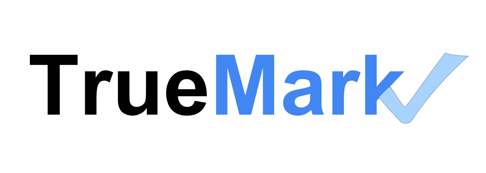

### Hello there! 

# I'm Dhruv Shetty

Founding engineer at **TrueMark**. Empowering educators to foster critical thinking with AI.

I'm the only engineer on the team. I joined when 2 teachers were using the product. Two years later it's **2,300+ teachers** and **45,000+ students** across **229 schools**.

 

**What I've built at TrueMark**

- The student writing editor, on TipTap and ProseMirror, with a pagination engine that lays essays out as real pages while students type: editable headers, page numbers, footnotes that stay on their page. Started from an open-source extension and outgrew it; TipTap shipped its own Pages extension 6 months later. 130,000+ essays run through it.
- AI grading and feedback: rubric parsing, per-criterion feedback, and a Socratic tutor that guides instead of answering. Evals on production traces (Langfuse) gate every prompt change. One teacher complaint that the tutor "writes for students" became a measured 13% vs 5.5% in 2 days, then a fix.
- Moved rubric parsing from gpt-4o to Gemini at ~65x lower cost, against an eval baseline so quality didn't slip.
- Integrations for 7 LMS platforms (Canvas, Schoology, Google Classroom, Microsoft Teams, Blackbaud, ManageBac, Genius SIS): SSO, rostering, grade sync.
- Split submit from grading: submit enqueues a Cloud Tasks job, Cloud Run workers generate the report. Load-tested to 5,000 concurrent students. On one district's benchmark day: 4,338 essays, 44 submits a minute at peak, 0 failures a student could see.

Full write-ups: [dhruvshetty.com/work/truemark](https://dhruvshetty.com/work/truemark)

 

**Before TrueMark**

- **Snacc**: co-founded an AI calorie tracker (Flutter, OpenAI vision). Beta in 2 months, ~1,000 users, $30k raised.
- **Pyramid Developers**: founded and ran a studio of up to 30 engineers for 5 years, 40+ products for startups.
- **Maigrate**: no-code RAG chatbot builder, embeddable with one script tag, on AWS ECS.
- **NYU**: MS in Computing, Entrepreneurship and Innovation. TA for DevOps and Agile. 2nd place in Yann LeCun's deep learning class challenge with WNet, a dual-UNet video segmentation model.

 

## 🛠 Tech Stack

#### Languages
      

#### Frontend
      

#### Backend
      

#### Cloud
      

#### AI
      

#### Observability
      

## 🎲 Things I built for myself

- [DKS Sports Day '27](https://27.dhruvshetty.com): my 27th birthday as a 6-a-side tournament. Teams, check-in, a 15-minute fixture grid, live scores, and a schedule that rebuilds itself if a venue falls through.
- [apt-search](https://dhruvshetty.com/apt-search/): built at a 6-person hackathon I hosted. Ranks NYC rentals in our zone by $/person and pings Discord when a new one appears.
- [We're Not Really Strangers](https://wnrs.dhruvshetty.com): the card game as a website, so it's always in the room.
- [Statement-Analyzer](https://github.com/Some1Somewhere/Statement-Analyzer): Gemini reads credit-card PDF statements, categorises every line, merges Splitwise, writes one CSV.

 

**Reach me:**

